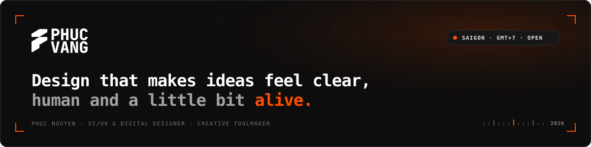

  

  
  
  
  

---

### `01` · About

I'm **Phuc Nguyen (Phuc Vang)** — an independent **UI/UX & Digital Designer** based in **Saigon, Vietnam**.  
Over the past **3+ years**, I've worked across the full path: research and concept, design systems, visual identity, interactive motion, live sites built in **Framer**, and custom creative workflow tools.

I care about the details nobody asks for — the rhythm of a loading screen, the feel of a micro-interaction, and the clarity that makes a digital product feel effortless.

---

### `02` · Products & Tools

| Product | Category | Description | Link |
| :--- | :--- | :--- | :---: |
| **HiCraft** | `Design Craft` | Creative design craft toolkit & workflow experiments. | [Explore →](https://phucvang.framer.website) |
| **HiPu Switcher** | `Utility` | Lightweight workspace & switcher utility built for speed. | [Explore →](https://phucvang.framer.website) |
| **HiEazy** | `Workflow Tool` | AI-assisted creative canvas & multi-model workflow tool. | [Explore →](https://phucvang.framer.website) |
| **Craftive Studio** | `Framer Template` | Editorial digital agency flagship website with Swiss grid discipline & motion. | [Live Site ↗](https://craftive-studio.framer.website) |

> *Tip: Khi bạn đẩy mã nguồn từng sản phẩm lên repo GitHub riêng, chỉ cần thay cột **Link** bằng đường dẫn repo hoặc trang release của sản phẩm đó.*

---

### `03` · Writing & Build Logs

> Nơi đăng các bài viết chia sẻ về UI/UX, Motion, Framer, Vibe Coding và nhật ký làm sản phẩm.  
> *(Bạn có thể tạo thư mục `/posts` ngay trong repo profile này hoặc gắn link bài viết từ GitHub Discussions / Medium / Notion.)*

- **`2026-11`** · [Designing Tactile Interactions & Camera-Viewfinder Portfolios in Framer](./posts/01-tactile-interactions.md) *(draft)*
- **`2026-11`** · [Building Creative Micro-Tools with Figma, Framer, Claude & Antigravity](./posts/02-creative-micro-tools.md) *(draft)*
- **`2026-11`** · [How I Optimized a Heavy Interactive Framer Site (-80% Images, 0 Idle Loops)](./posts/03-framer-performance.md) *(draft)*

---

### `04` · Stack & Tools

  
  
  
  
  
  
  
  

---

### `05` · Connect

- **Portfolio:** [phucvang.framer.website](https://phucvang.framer.website)
- **Email:** [14phucs@gmail.com](mailto:14phucs@gmail.com)
- **LinkedIn:** [Phúc Nguyễn](https://www.linkedin.com/in/ph%C3%BAc-nguy%E1%BB%85n-6555aa261/)
- **Instagram:** [@14phucs](https://www.instagram.com/14phucs/)
- **Facebook:** [facebook.com/14phucs](https://www.facebook.com/14phucs)

  PHUC NGUYEN · PHUC VANG · SAIGON, VIETNAM · 2026

